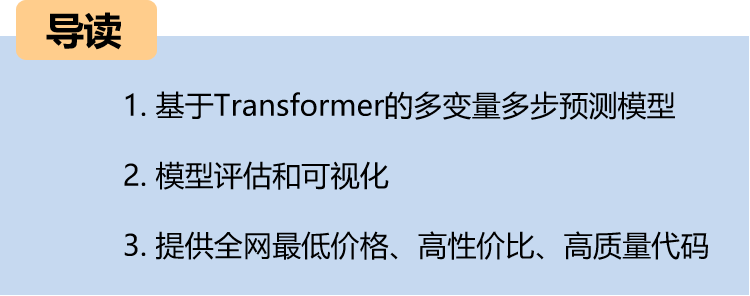
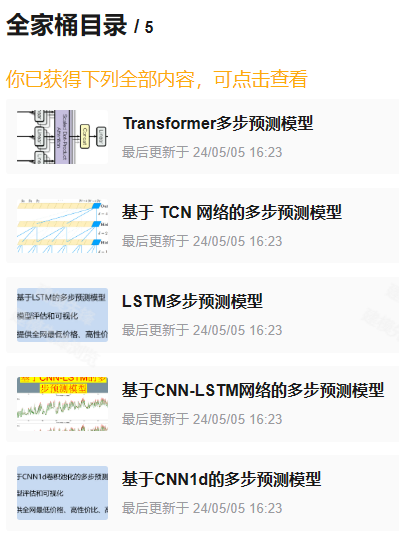
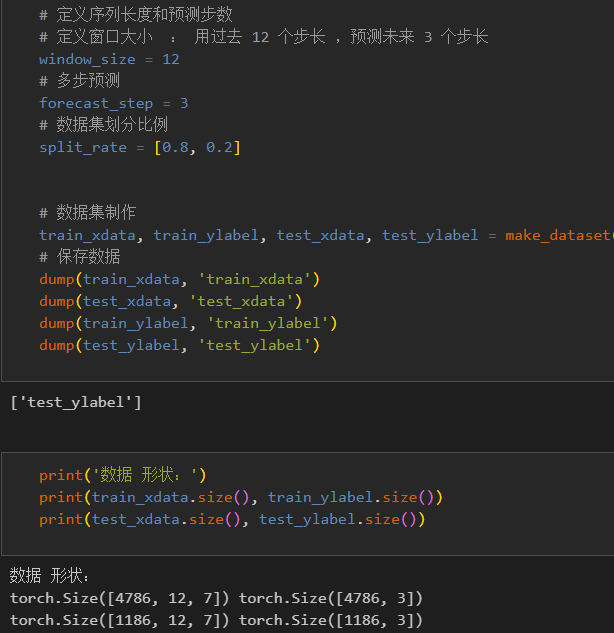
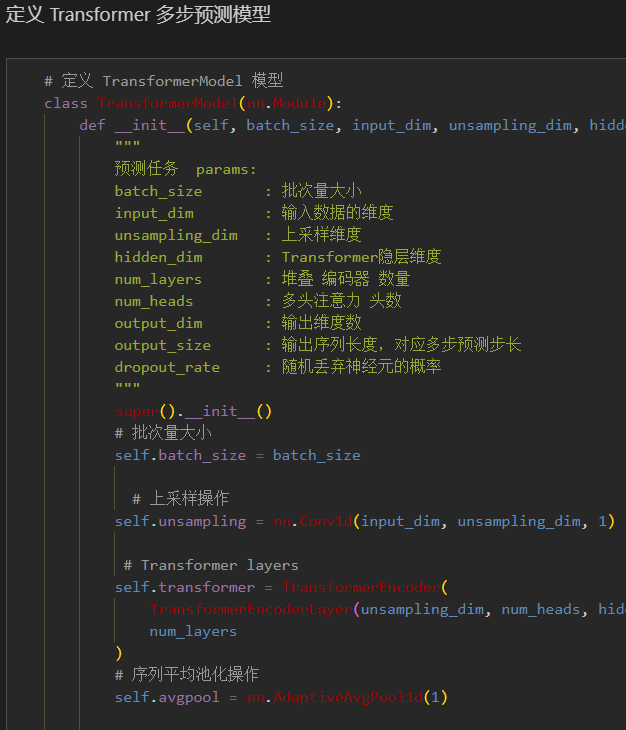
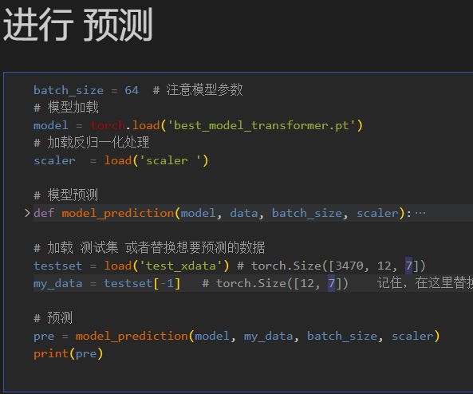
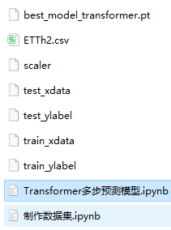

# Multi-step Transformer Prediction Model (Multi-features)

Including complete process data code processing: multi-step prediction dataset creation, data loading, model definition, parameter setting, model training, model testing, prediction visualization, multi-step prediction, model evaluation.
● Environment Framework: Python 3.9, PyTorch 1.8 and above can be run.
● Usage Object: Paper requirements, graduation design requirements.
● Code Guarantee: The code comments are detailed and ready to run.
Including complete process data code processing:
Multi-step prediction dataset creation, data loading, model definition, parameter setting, model training, model testing, prediction visualization, multi-step prediction, model evaluation.
The lowest price on the network, with a multi-step tutorial for beginners, download method:
Code and file introduction:
Preface
This paper is based on the previous introduction of power transformers (data set attached at the end) and introduces a multi-feature, multi-step prediction model based on Transformer networks.
The detailed introduction to the power transformer dataset can be found in the following text:
Introduction to the Power Transformer Dataset and Preprocessing
1 Data Preprocessing and Visualization of Electric Power Transformers
1.1 Import data
1.2 Multi-step Preprocessing for Prediction
2. Multi-variable multi-step prediction model based on Transformer
2.1 Define the Transformer network model
\t  
2.2 Set parameters and train the model
\t\t  
50 epochs, MSE is 0.002328, the Transformer multi-step prediction model has a significant effect on prediction, the model can fully extract the spatiotemporal features of the sequence, converges quickly, and has excellent performance. The prediction accuracy is high. By appropriately adjusting the model parameters, it can further improve the model's predictive performance.
\tNote: Adjust parameters.
\tThe number of Transformer encoder layers and attention dimensions can be appropriately adjusted.
\tIncrease more epochs (note to prevent overfitting)
1. Adjustable sliding window length (set an appropriate window length)
3. Results visualization and prediction, model evaluation
3.1 Visualization of prediction results
3.2 Load the model for prediction
3.3 Model evaluation
Click to download: Full original data, Python code
Previously excellent content:
Time series forecasting: Analysis and comparison of LSTM, ARIMA, Holt-Winters, SARIMA models
Wind speed prediction (I): Data introduction and preprocessing
Wind speed prediction (II): EMD-LSTM model based on Pytorch
Wind speed prediction (III): EMD-LSTM-Attention model
Wind speed prediction (IV): EMD-Transformer model based on Pytorch
Wind speed prediction (V): EMD-CNN-LSTM model based on Pytorch
Wind speed prediction (VI): EMD-CNN-GRU parallel model based on Pytorch
CEEMDAN + combined forecasting model (BiLSTM-Attention + ARIMA)
CEEMDAN + combined forecasting model (CNN-LSTM + ARIMA)
CEEMDAN + combined forecasting model (Transformer - BiLSTM + ARIMA)
CEEMDAN + combined forecasting model (CNN-Transformer + ARIMA)
Multi-feature variable sequence prediction (I): CNN-LSTM wind speed prediction model
Multi-feature variable sequence prediction (II): CNN-LSTM-Attention wind speed prediction model
Multi-feature variable sequence prediction (III): CNN-Transformer wind speed prediction model
Multi-feature variable sequence prediction (IV): Transformer-BiLSTM wind speed prediction model
Multi-feature Variable Sequence Prediction (5) CEEMDAN+CNN-LSTM Wind Speed Prediction Model
Multi-feature Variable Sequence Prediction (6) CEEMDAN+CNN-Transformer Wind Speed Prediction Model
Prediction Model Based on the Particle Swarm Optimization Algorithm SSA: CEEMDAN-BiLSTM-Attention
Prediction Model Based on the Particle Swarm Optimization Algorithm SSA: CEEMDAN-Transformer-BiGRU
Superior Prediction Model: Secondary Decomposition-Combination Prediction
Multi-feature Variable Sequence Prediction (7) CEEMDAN+Transformer-BiLSTM Prediction Model
Multi-feature Variable Sequence Prediction (8) CEEMDAN-SSA-BiLSTM Prediction Model Based on the Particle Swarm Optimization Algorithm
Multi-feature Variable Sequence Prediction (11) TCN-GRU Prediction Model Based on Pytorch
VMD + CEEMDAN Secondary Decomposition, CNN-LSTM Prediction Model
VMD + CEEMDAN Secondary Decomposition, CNN-Transformer Prediction Model
VMD + CEEMDAN Secondary Decomposition, Transformer-BiGRU Prediction Model
Prediction Model Based on the Particle Swarm Optimization Algorithm SSA - Complete Code Kit
Introduction to Electric Power Transformer Data Set and Preprocessing
 | Sci-Tech 1 Region High Innovative Prediction Model!
END

## Images

<!-- PAYMENT_BLOCK -->

## Get this dataset

- Payment link (Stripe): [Buy now](https://buy.stripe.com/3cs8yP7sY87d0vu9AB)
- Payment QR code: 

<!-- /PAYMENT_BLOCK -->
